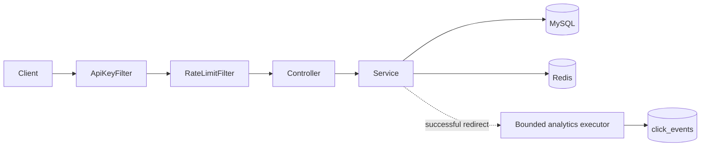

# URL Shortener with Analytics and Rate Limiting

A Java 17 / Spring Boot URL shortener backed by MySQL and Redis. It provides
owner-scoped link management, cache-aside redirects, asynchronous click
analytics, and a Redis-backed token bucket rate limiter.

## Project layout

```
url-shortener/
├── backend/               Spring Boot API (Java 17, Maven)
│   ├── pom.xml
│   ├── Dockerfile
│   └── src/
├── frontend/              React + Vite web app
│   ├── package.json
│   └── src/
├── performance/           k6 load-test scripts
├── docker-compose.yml     MySQL + Redis (and optionally the backend)
├── .env.example           copy to .env and set your local passwords
└── RUN_LOCALLY.md         step-by-step guide for running everything on your computer
```

## Quick start

New to this project? Follow **[RUN_LOCALLY.md](RUN_LOCALLY.md)**. The short version:

```bash
cp .env.example .env                      # then edit the two passwords
docker compose up -d mysql redis          # database + cache
cd backend && mvn spring-boot:run         # API on http://localhost:8080
cd frontend && npm install && npm run dev # website on http://localhost:5173
```

## Architecture



The application layers requests as controller -> service -> repository and
returns DTOs rather than JPA entities. Browser requests are restricted to the
configured frontend origin; the rate-limit and redirect headers needed by
browser code are exposed through CORS.

## Run everything in Docker

Prerequisite: Docker Desktop with Compose. Copy `.env.example` to `.env` and set the two
passwords (Compose reads `.env` automatically):

```bash
docker compose up --build -d
docker compose ps
curl http://localhost:8080/api/health
```

The health endpoint reports `UP` only when both MySQL and Redis are reachable. Compose starts
MySQL 8.4, Redis 7, and the backend; MySQL and Redis data are stored in named volumes. The
application uses Bucket4j by default.

To create an API key, run the application's one-shot command and save the printed key (it is
not stored in plaintext):

```bash
docker compose run --rm app --create-api-key
```

To stop the services, run `docker compose down`. Add `-v` only if you also want to remove the
MySQL and Redis data volumes.

The optional `frontend` Compose profile serves the built React app with nginx on port 5173. Build
it first, then start the profile:

```bash
cd frontend && npm install && npm run build && cd ..
docker compose --profile frontend up -d
```

`frontend/.env.production` makes that build call the backend directly at `http://localhost:8080`,
so the browser origin (`FRONTEND_ORIGIN`, default `http://localhost:5173`) must match the address
you open. For everyday development, use `npm run dev` instead (see below).

## Local development

Run only MySQL and Redis in Docker, and run the backend and frontend directly on your computer.
The full beginner guide is in [RUN_LOCALLY.md](RUN_LOCALLY.md).

```bash
docker compose up -d mysql redis       # from the project root
cd backend
mvn spring-boot:run                    # http://localhost:8080
```

In a second terminal:

```bash
cd frontend
npm install
npm run dev                            # http://localhost:5173
```

The backend reads `MYSQL_PASSWORD` (and the other settings below) from real environment
variables or from the `.env` file in the project root. Override database/Redis addresses with
`SPRING_DATASOURCE_URL`, `MYSQL_USER`, `MYSQL_PASSWORD`, `REDIS_HOST`, and `REDIS_PORT`;
`SERVER_PORT` changes the server port.

In development, Vite forwards every `/api` call from the browser to the backend, so no CORS setup
is needed. Short links open on the backend (`http://localhost:8080/<code>`); change
`VITE_SHORT_LINK_BASE_URL` (see `frontend/.env.example`) if you move the backend.

To create an API key, MySQL and Redis must be running (the backend itself can be stopped). From `backend/`:

```bash
mvn spring-boot:run "-Dspring-boot.run.arguments=--create-api-key"
```

Copy the value printed after `API_KEY=` and paste it into the website.

## API

Protected endpoints require `X-API-Key`. Each API key owns its URLs and
analytics; attempts to access another owner's link return 404.

| Method | Path | Purpose | Success |
|---|---|---|---|
| `GET` | `/api/health` | Database and Redis health | `200` when both are up; otherwise `503` |
| `POST` | `/api/urls` | Create a short link | `201` |
| `GET` | `/api/urls` | List the current owner's links | `200` |
| `GET` | `/api/urls/{id}` | Get an owned link | `200` |
| `DELETE` | `/api/urls/{id}` | Deactivate an owned link | `204` |
| `GET` | `/{code}` | Redirect to the destination | `302`; `404` unknown/inactive; `410` expired |
| `GET` | `/api/keys/me/usage` | Inspect the creation bucket without consuming a token | `200` |
| `GET` | `/api/urls/{id}/stats` | Total clicks for an owned link | `200` |
| `GET` | `/api/analytics/daily?urlId={id}&from={date}&to={date}` | Inclusive UTC daily counts | `200` |
| `GET` | `/api/analytics/summary` | Owner-wide clicks, referrers, and device categories | `200` |

Link responses contain `id`, `originalUrl`, `shortCode`, `shortUrl` (a path such as `/abc`,
opened on the backend host), `createdAt`, and `active` (`false` after deactivation).

Create a link with an optional custom alias:

```powershell
Invoke-RestMethod -Method Post -Uri http://localhost:8080/api/urls `
  -Headers @{ "X-API-Key" = $env:API_KEY } `
  -ContentType "application/json" `
  -Body '{"originalUrl":"https://example.com/article","customAlias":"my-article"}'
```

Short codes generated by the service encode the database auto-increment ID in
Base62 (`0-9a-zA-Z`). Custom aliases are limited to 3-30 letters, digits,
underscores, or hyphens; reserved aliases and duplicates are rejected.

## Design decisions

### Case-sensitive short codes

Base62 uses both `a` and `A`, so `urls.short_code` must be case-sensitive. MySQL's default
collation is not, which would make link number 36 (`A`) collide with link number 10 (`a`) and
make `/A` open the wrong link. The column is therefore created with `utf8mb4_bin`. If your
database was created before this change, fix the existing column once:

```sql
ALTER TABLE urls MODIFY short_code VARCHAR(30) CHARACTER SET utf8mb4 COLLATE utf8mb4_bin;
```

(or start fresh with `docker compose down -v`, which deletes all stored data).

### Redirect cache-aside

Redirect values are cached under `url:{code}` for 30 minutes. The cache stores
a small DTO (destination, active state, and expiry), not a JPA entity. A cache
miss falls back to MySQL; a cached URL still checks `expires_at`, which is
independent of the Redis TTL. Unknown codes are not negatively cached to avoid
stale 404s if a code is created later. Redis errors are warning-logged and
redirects fall back to MySQL. The redirect rate limiter also fails open: if Redis is
unreachable, redirects are served without rate limiting (and a warning is logged), while
the authenticated API endpoints still require Redis. Deactivation evicts the cache after the database
transaction commits. Rate limiting uses the separate `rate_limit:` namespace.

### Token bucket rate limiting

Bucket4j is the default Redis-backed implementation, selected with
`RATE_LIMIT_PROVIDER=bucket4j`; `RATE_LIMIT_PROVIDER=lua` selects the retained
custom Lua implementation. Both use the same configured endpoint limits,
response headers, and 429 JSON response. The Lua implementation makes the
refill/consume algorithm explicit in one atomic script and uses Redis server
time. Bucket4j delegates bucket arithmetic and distributed coordination to a
maintained library and its Lettuce integration. The API-key creation limit is
per key (default capacity 10, refill 10/min); analytics is 30/min. Public
redirects are limited per client IP (default capacity 120, refill 2/sec).
Refill rates are tokens per second. Override the defaults with
`RATE_LIMIT_CREATE_CAPACITY`, `RATE_LIMIT_CREATE_REFILL_RATE`,
`RATE_LIMIT_ANALYTICS_CAPACITY`, `RATE_LIMIT_ANALYTICS_REFILL_RATE`,
`RATE_LIMIT_REDIRECT_CAPACITY`, and `RATE_LIMIT_REDIRECT_REFILL_RATE`.
`GET /api/keys/me/usage` reports the current creation bucket without spending
a token.

For an existing database that predates per-key bucket settings, add the
columns before deploying:

```sql
ALTER TABLE api_keys
  ADD COLUMN capacity INT NOT NULL DEFAULT 10,
  ADD COLUMN refill_rate DOUBLE NOT NULL DEFAULT 0.1666666667;
```

If that database instead has a legacy `requests_per_window` column measured
per minute, migrate its values before dropping it:

```sql
UPDATE api_keys
  SET capacity = requests_per_window,
      refill_rate = requests_per_window / 60.0;
ALTER TABLE api_keys DROP COLUMN requests_per_window;
```

### Asynchronous click analytics

Every successful redirect submits one event (URL, timestamp, referrer, and
user-agent) to a bounded `ThreadPoolTaskExecutor`. Pool sizes and queue
capacity are configurable with `ANALYTICS_CORE_POOL_SIZE`,
`ANALYTICS_MAX_POOL_SIZE`, and `ANALYTICS_QUEUE_CAPACITY`. Queue rejection or a
database write failure is logged and does not fail the redirect. Events waiting
in the in-memory queue can be lost if the application crashes. Durable delivery
would use a persistent broker such as Kafka or RabbitMQ, with retries and
dead-letter handling.

## Performance tests (k6)

Three scripts live in `performance/`:

1. `redirect-load.js` measures separate cold (first access for each supplied
   code) and warm-cache redirect latency.
2. `url-creation-load.js` drives URL creation above the configured limit and
   reports `201`, `429`, p95 latency, and request rate. Creation returns HTTP
   `201 Created` in this API, so the script reports 201 (not 200) as success.
3. `token-bucket-burst.js` sends a burst at a dedicated key, waits for a token
   to refill, and reports accepted/rejected requests for both stages.

Use a dedicated test API key and disposable links; creation tests write links
to MySQL. For the redirect test,
provide existing, distinct codes that have not been requested since the app
started; pre-warm the `WARM_CODE` separately. Run scripts from the repository
root (the `performance/` folder):

```powershell
$env:BASE_URL = "http://localhost:8080"
$env:API_KEY = "dedicated-test-key"
$env:COLD_CODES = "cold-code-1,cold-code-2"
$env:WARM_CODE = "prewarmed-code"
k6 run .\performance\redirect-load.js

$env:CREATE_RATE = "20"
$env:CREATE_DURATION = "30s"
k6 run .\performance\url-creation-load.js

$env:BUCKET_CAPACITY = "10"
$env:BUCKET_REFILL_RATE = "0.1666666667"
k6 run .\performance\token-bucket-burst.js
```

**Benchmark status:** no live benchmark numbers are reported because the Docker
engine was unavailable and k6 was not installed in the environment used for
this change. The scripts are ready to run against a live Compose stack. Do not
interpret connection failures as application performance results. The
environment available for this change was Windows 11 x64, Java 17.0.12, an
Intel Core i5-11400H (6 cores / 12 logical processors), and 15.7 GB RAM; the
benchmark stack settings are MySQL 8.4, Redis 7, 10-token creation capacity,
and a 10/minute creation refill by default. Populate p95 latency, requests/sec,
and status counts from actual k6 output before claiming benchmark results.

## Build and tests

```bash
cd backend
mvn test
mvn package
```

Testcontainers integration tests require a working Docker engine. Unit and service tests can run
with Maven without starting the application services. To run the Redis integration test without
Docker, set `TEST_REDIS_HOST` and `TEST_REDIS_PORT`.

## Known limitations

- Generated Base62 codes are sequential and guessable; they are not intended
  to be secrets.
- Click events awaiting asynchronous persistence can be lost on process crash
  or executor saturation.
- Redis and MySQL are used as single-region services; the design does not
  address cross-region consistency or failover.
- Redis is required for rate limiting of the authenticated API. Redirects keep working
  without Redis (served from MySQL, without rate limiting).
- Performance results are not included until measured on a running stack.
- The frontend is a small dashboard. API keys can only be created from the command line, and
  links cannot yet be given an expiry date from the UI or API.
